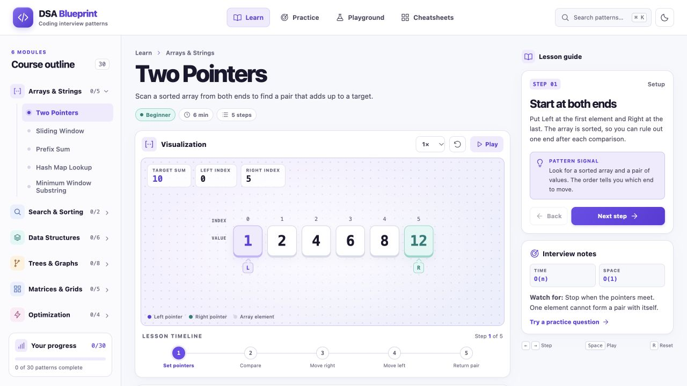
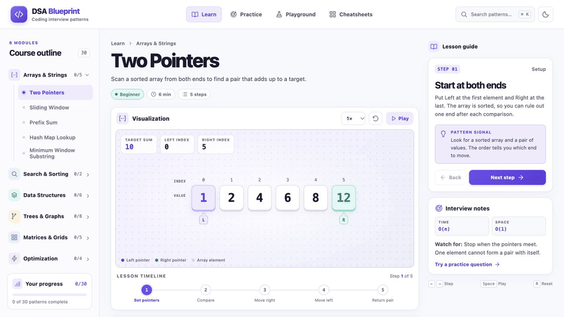
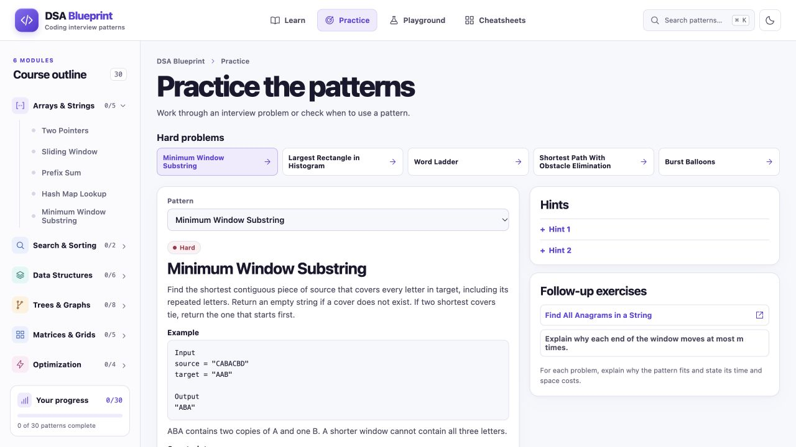
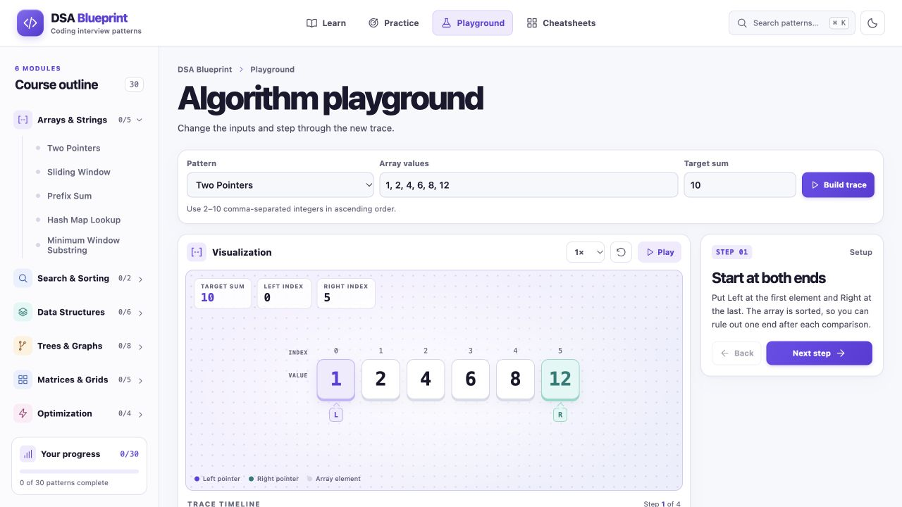

# DSA Blueprint 🧭

An interactive course for learning coding interview patterns. Follow an algorithm one step at a time, test your understanding, and build traces with your own inputs.

[Open the app](https://www.lprakashv.com/dsa-blueprint/) · [Contribute](CONTRIBUTING.md) · [Agent guide](AGENTS.md)



<details>
<summary>See the app in three views</summary>



</details>

## Explore the course

- **Learn:** Work through 30 lessons in six modules. Each lesson includes a diagram, a step guide, complexity notes, and a Python implementation.
- **Practice:** Answer pattern questions or explore five hard problems with examples, hints, and links to LeetCode.
- **Playground:** Build traces with your own inputs for Two Pointers, Sliding Window, and Binary Search.
- **Cheatsheets:** Review pattern signals, complexity, and Python templates.

| Practice a hard problem 🎯 | Build a custom trace 🧪 |
| --- | --- |
|  |  |

Use the timeline or arrow keys to move between steps. Press Space to play or pause, and R to reset. The app stores completed lessons and the theme in browser local storage. Clearing browser data can remove them.

## Run locally 🚀

You need Node.js 22.12 or later, npm, and Python 3. There are no npm packages to install.

```sh
git clone https://github.com/lprakashv/dsa-blueprint.git
cd dsa-blueprint
npm run dev
```

Open [http://127.0.0.1:4173/](http://127.0.0.1:4173/). Stop the server with Ctrl+C.

## Checks

```sh
npm run lint
npm test
npm run coverage
npm run build
```

Lint checks JavaScript syntax and source whitespace. Tests check lesson data, diagrams, routes, playground traces, and Python examples. Coverage reports the JavaScript modules loaded by the tests; it does not measure browser interactions. See [CONTRIBUTING.md](CONTRIBUTING.md) for the change and review process.

## Project map

| Path | Purpose |
| --- | --- |
| `site/index.html`, `site/src/app.js` | App shell, views, and interactions |
| `site/src/lessons.js`, `*-lessons.js`, `lesson-content.js` | Course data and lesson helpers |
| `site/src/diagrams.js`, `trace.js` | Diagram rendering and playground algorithms |
| `site/src/navigation.js`, `icons.js`, `style.css` | Routes, icons, and visual styles |
| `test/` | Node tests and Python example checks |
| `scripts/` | Static build and lint scripts |
| `.github/workflows/` | Checks and GitHub Pages deployment |

## Deploy

Build and preview the production files:

```sh
npm run build
npm run run
```

Open [http://127.0.0.1:4174/](http://127.0.0.1:4174/) and stop the server with Ctrl+C. Publish the contents of `dist/` to a static host. Fragment routes work when the site is hosted at the root or in a subdirectory.

The [GitHub Pages workflow](.github/workflows/deploy-pages.yml) runs checks on pull requests to `main` and builds and deploys on pushes to `main` or manual dispatch. In repository settings, set **Pages → Build and deployment → Source** to **GitHub Actions**. The configured project endpoint is [www.lprakashv.com/dsa-blueprint](https://www.lprakashv.com/dsa-blueprint/).

## Credits and license

The course outline, central diagram, and step guide take inspiration from [Designed to Scale](https://designed-to-scale.vercel.app/#/). DSA Blueprint has its own lesson content and visual design.

The B-tree example uses minimum degree 2. The B+ tree example uses the first key in the right subtree as a separator and shows record keys in the leaves. See [OpenDSA](https://opendsa-server.cs.vt.edu/OpenDSA/Books/CS3/html/BTree.html). The graph lessons include Union-Find and shortest-path algorithms; see [Princeton](https://algs4.cs.princeton.edu/15uf/) and [MIT](https://ocw.mit.edu/courses/6-006-introduction-to-algorithms-sma-5503-fall-2005/resources/lecture-videos/).

Released under the [MIT License](LICENSE).
